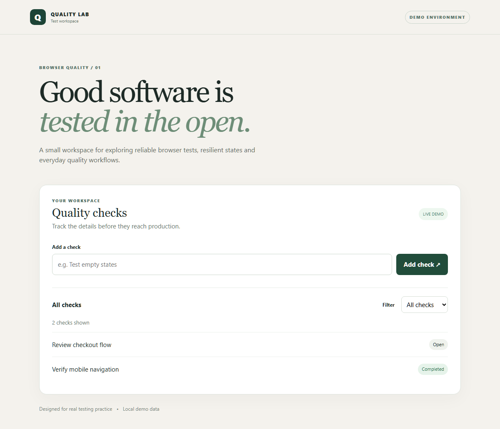

# Browser Quality Lab

A small, dependency-light demo application and a Playwright suite showing practical browser-testing techniques. The application uses local demo data; new checks are kept only in memory until the next reload.

## Run locally

Requires Node.js 20+. Install with `npm ci`, then `npx playwright install chromium firefox webkit`. Run `npm start` for the app at http://127.0.0.1:4173, or `npm test` for all projects. `npx playwright test --project=chromium` runs one browser. `npm run report` opens the HTML report after a test run.

## What is covered

- User-visible loading, filtering and empty states through role and label locators.
- Keyboard form submission and safe rendering of user-provided text.
- A deterministic API failure followed by recovery using network interception.
- Chromium, Firefox, WebKit and mobile Chromium; CI keeps traces and screenshots on failure.

The suite is intentionally small: it demonstrates these paths rather than claiming full accessibility, security or production coverage. It runs against an isolated local example, not a live service.

The CI workflow publishes the Playwright HTML report as a short-lived artifact when a test fails; artifacts may include screenshots and traces of synthetic demo data.
